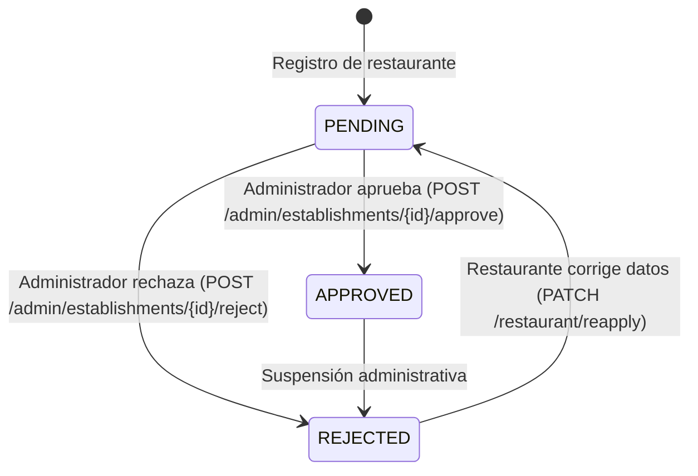

# Plan Técnico de Backend: Cuentas y Gestión de Restaurantes (PlanATi)

> **Destinatario de ejecución:** Claude Code (CLI).  
> **Ubicación:** `PlanATi_Backend/` (Directorio raíz del backend).  
> **Contexto de ejecución:** Este documento contiene las instrucciones técnicas paso a paso para implementar la arquitectura de backend de cuentas de restaurantes, aprobaciones administrativas, catálogo de productos/combos, gestión de imágenes y exposición pública controlada.

---

## 1. Objetivo y alcance

### 1.1 Objetivo
Extender la API existente en FastAPI y SQLAlchemy 2.x para dar soporte integral al ciclo de vida de los restaurantes en la plataforma PlanATi:
1. Registro e inicio de sesión independiente para restaurantes con credenciales seguras, incluyendo información del establecimiento (nombre, categoría, dirección, teléfono, correo de contacto, descripción, fotos y nombre del gerente).
2. Flujo de aprobación administrativa (`PENDING`, `APPROVED`, `REJECTED`) con autorización estricta en el backend y mecanismo de reintento/re-aplicación tras rechazo.
3. Exención de verificación telefónica por SMS (OTP) para restaurantes, gobernando su acceso exclusivamente por el estado de aprobación del establecimiento (`APPROVED`).
4. Panel administrativo para auditar solicitudes y gestionar establecimientos con prevención de operaciones incompatibles.
5. Panel privado del restaurante para gestión de perfil, fotos de galería y menú físico, productos y combos (en sus dos modalidades: unitario independiente o compuesto por catálogo).
6. Exposición pública en el directorio y detalle únicamente de establecimientos aprobados, con soporte visual para reseñas sin implementar nueva lógica de calificación/comentarios.
7. Gestión de perfil de usuario regular y cierre de sesión seguro mediante cookie `HttpOnly`.

### 1.2 Alcance fuera de esta fase (Exclusiones estrictas)
- **NO** implementar publicación ni edición de reseñas por parte de usuarios finales.
- **NO** implementar respuestas a reseñas en esta fase.
- **NO** implementar subida de imágenes vinculadas a reseñas.
- **NO** implementar pasarelas de pago ni pedidos en línea.
- **NO** implementar sistemas nuevos de recuperación de contraseñas ni envíos de correos transaccionales (SMTP/SES) al no existir actualmente en el proyecto.

---

## 2. Resumen del estado actual del backend

| Componente | Estado actual | Detalle técnico |
|---|---|---|
| **Framework** | FastAPI 0.115.12 | Enrutamiento modular con prefijo `/api/v1` en `app/main.py`. |
| **ORM & DB** | SQLAlchemy 2.0.40 + Alembic 1.15.2 | Modelos asíncronos en `app/models/`, PostgreSQL/PostGIS para prod, SQLite memoria para tests. |
| **Autenticación** | JWT con Cookie `HttpOnly` y Bearer fallback | Implementado en `app/core/security.py` y `app/api/dependencies.py`. Cookie `access_token` configurable. |
| **Roles actuales** | `user` y `admin` | Columna `User.role` (String 30) validada en `app/api/routes/admin.py` y `dependencies.py`. Se extiende para admitir `"restaurant"`. |
| **Establecimientos** | Modelo básico `Establishment` | En `app/models/establishment.py` con `owner_id`, `name`, `category`, `address`, `schedules`, `menu_items`, `reviews`. Carece de `status`, fotos (perfil/banner/galería) y datos de contacto propios. |
| **Productos (`MenuItem`)** | Modelo plano `MenuItem` | En `app/models/establishment.py`. Contiene `name`, `description`, `price`. No tiene soporte para imagen ni combos. |
| **Almacenamiento** | Cloudflare R2 vía Boto3 | `app/services/storage.py` (`R2StorageService`). Genera URLs prefirmadas PUT. Variables en `.env` y `.env.example`. |
| **Reseñas existentes** | Implementadas en `app/api/routes/reviews.py` | Rutas funcionales que no deben romperse; deben permanecer aisladas de la nueva gestión de restaurantes. |

---

## 3. Arquitectura y convenciones existentes

1. **Configuración centralizada:** Todas las variables provienen de `app/core/config.py` (`Settings`) mediante `pydantic-settings`.
2. **Inyección de dependencias:** 
   - `get_db`: Sesión asíncrona de base de datos (`AsyncSession`).
   - `get_current_user`: Extrae y valida el JWT desde la cookie `access_token` o cabecera `Authorization: Bearer <token>`.
   - `require_admin`: Exige `current_user.role == "admin"` y usuario activo.
   - `require_restaurant_user`: Resuelve el establecimiento asociado al usuario autenticado.
   - `require_approved_restaurant`: Valida que el establecimiento esté en estado `APPROVED`.
3. **Manejo de contraseñas:** `pwdlib[argon2]` con hash seguro en `app/core/security.py`.
4. **Respuestas y esquemas:** Modelos Pydantic v2 en `app/schemas/` con `from_attributes = True`.
5. **Aislamiento de inquilinos (Multi-tenant por propietario):** El backend nunca debe recibir ni confiar en un `establishment_id` enviado por el cliente para operaciones de escritura del restaurante; debe resolver el establecimiento consultando `where(Establishment.owner_id == current_user.id)`.

---

## 4. Modelos y entidades: Reutilización, modificación y creación

### 4.1 Entidad `User` (`app/models/user.py`)
- **Modificación:** Permitir el rol `"restaurant"` en la columna `role: Mapped[str]`.
- **Regla de verificación:** Para usuarios con rol `"restaurant"`, `phone_verified` se establece en `True` y `status="ACTIVE"` al crearse la cuenta, asegurando que no queden bloqueados por el flujo de SMS OTP destinado a usuarios regulares.
- **Relaciones:** Añadir relación hacia `Establishment`:
  ```python
  establishments: Mapped[list["Establishment"]] = relationship(
      back_populates="owner", cascade="all, delete-orphan"
  )
  ```

### 4.2 Entidad `Establishment` (`app/models/establishment.py`)
- **Campos existentes:** `name`, `category`, `address`, `description`, `latitude`, `longitude`, `price_range` se mantienen íntegros. `category` y `address` son provistos obligatoriamente desde el registro inicial.
- **Campos nuevos que deben añadirse:**
  - `status: Mapped[str] = mapped_column(String(30), default="PENDING", index=True, nullable=False)` (Valores: `PENDING`, `APPROVED`, `REJECTED`).
  - `rejection_reason: Mapped[str | None] = mapped_column(Text, nullable=True)` (Motivo administrativo en caso de rechazo).
  - `phone: Mapped[str] = mapped_column(String(20), nullable=False)` (Teléfono comercial del establecimiento).
  - `contact_email: Mapped[str] = mapped_column(String(255), nullable=False)` (Correo público de contacto comercial, distinto al correo de cuenta).
  - `profile_image_url: Mapped[str | None] = mapped_column(String(500), nullable=True)` (Logo o avatar del restaurante).
  - `banner_image_url: Mapped[str | None] = mapped_column(String(500), nullable=True)` (Foto de portada o banner).
  - `manager_name: Mapped[str | None] = mapped_column(String(120), nullable=True)` (Nombre del gerente responsable).
- **Relaciones nuevas:**
  - `owner: Mapped["User"] = relationship(back_populates="establishments")`
  - `images: Mapped[list["EstablishmentImage"]] = relationship(back_populates="establishment", cascade="all, delete-orphan", lazy="selectin")`

### 4.3 Entidad `MenuItem` (`app/models/establishment.py`)
- **Reutilización y extensión:** Se reutiliza `MenuItem` para todos los ítems comercializables del catálogo (productos simples y combos).
- **Campos nuevos:**
  - `image_url: Mapped[str | None] = mapped_column(String(500), nullable=True)`
  - `is_combo: Mapped[bool] = mapped_column(Boolean, default=False, nullable=False)`
  - `is_available: Mapped[bool] = mapped_column(Boolean, default=True, nullable=False)`
  - `created_at: Mapped[datetime] = mapped_column(DateTime(timezone=True), server_default=func.now(), nullable=False)`
  - `updated_at: Mapped[datetime] = mapped_column(DateTime(timezone=True), server_default=func.now(), onupdate=func.now(), nullable=False)`
- **Relaciones nuevas:**
  - `combo_items: Mapped[list["ComboItem"]] = relationship("ComboItem", foreign_keys="[ComboItem.combo_id]", back_populates="combo", cascade="all, delete-orphan", lazy="selectin")`

### 4.4 Nueva Entidad `ComboItem` (`app/models/establishment.py`)
Representa la relación N:M entre un combo y sus productos asociados (Modalidad 2: Combo compuesto):
```python
class ComboItem(Base):
    __tablename__ = "combo_items"

    id: Mapped[int] = mapped_column(Integer, primary_key=True)
    combo_id: Mapped[int] = mapped_column(
        ForeignKey("menu_items.id", ondelete="CASCADE"), nullable=False, index=True
    )
    product_id: Mapped[int] = mapped_column(
        ForeignKey("menu_items.id", ondelete="RESTRICT"), nullable=False, index=True
    )
    quantity: Mapped[int] = mapped_column(Integer, default=1, nullable=False)

    combo: Mapped["MenuItem"] = relationship("MenuItem", foreign_keys=[combo_id], back_populates="combo_items")
    product: Mapped["MenuItem"] = relationship("MenuItem", foreign_keys=[product_id], lazy="joined")
```

### 4.5 Nueva Entidad `EstablishmentImage` (`app/models/establishment.py`)
Representa la galería visual y las fotos del menú físico del restaurante:
```python
class EstablishmentImage(Base):
    __tablename__ = "establishment_images"

    id: Mapped[int] = mapped_column(Integer, primary_key=True)
    establishment_id: Mapped[int] = mapped_column(
        ForeignKey("establishments.id", ondelete="CASCADE"), nullable=False, index=True
    )
    image_url: Mapped[str] = mapped_column(String(500), nullable=False)
    image_type: Mapped[str] = mapped_column(String(20), nullable=False)  # "GALLERY" o "MENU"
    caption: Mapped[str | None] = mapped_column(String(150), nullable=True)
    display_order: Mapped[int] = mapped_column(Integer, default=0, nullable=False)
    created_at: Mapped[datetime] = mapped_column(
        DateTime(timezone=True), server_default=func.now(), nullable=False
    )

    establishment: Mapped["Establishment"] = relationship(back_populates="images")
```

---

## 5. Relaciones, restricciones e integridad de datos

1. **Aislamiento por propiedad:** Todo `Establishment` tiene un `owner_id` no nulo apuntando a `users.id`.
2. **Restricción de Combos (`combo_items`):**
   - El `product_id` no puede ser idéntico al `combo_id`.
   - El producto referenciado debe pertenecer obligatoriamente al mismo `establishment_id`.
   - `ondelete="RESTRICT"` en `product_id`: Un producto del catálogo que forme parte de un combo activo no puede ser eliminado silenciosamente. Si se intenta eliminar un producto enlazado a un combo, la API rechaza la operación con código `409 CONFLICT` indicando los nombres de los combos afectados.
3. **Restricciones de unicidad:**
   - `User.email` es único en el sistema e identifica la cuenta de acceso.
   - `Establishment.contact_email` es el canal de contacto comercial público.
4. **Integridad de estados:** Valores permitidos para `Establishment.status`: `{"PENDING", "APPROVED", "REJECTED"}`.

---

## 6. Estados y transiciones del proceso de aprobación



### Reglas de transición:
- **Al registrarse:** Se crea el usuario con `role="restaurant"`, `status="ACTIVE"`, `phone_verified=True` y el establecimiento con `status="PENDING"`.
- **Intento de acceso al panel privado:**
  - Si el establecimiento está en `PENDING` o `REJECTED`, las rutas protegidas de `/api/v1/restaurant/**` (excepto `/api/v1/restaurant/status` y `/api/v1/restaurant/reapply`) responden `403 FORBIDDEN` con mensaje estructurado:
    ```json
    { "detail": "Establecimiento en revisión", "status": "PENDING" }
    ```
- **Aprobación administrativa:** `Establishment.status = "APPROVED"`, `rejection_reason = None`.
- **Rechazo administrativo:** `Establishment.status = "REJECTED"`, guarda `rejection_reason`.
- **Re-aplicación tras rechazo:** El restaurante llama a `PATCH /api/v1/restaurant/reapply` enviando las correcciones. El backend actualiza los campos, elimina el motivo anterior y cambia `Establishment.status = "PENDING"`.
- **Acciones incompatibles:** Si un administrador intenta aprobar un restaurante que ya está en `APPROVED`, o rechazar uno ya en `REJECTED`, el backend responde `409 CONFLICT`.

---

## 7. Contratos de API (Endpoints del Backend)

Prefijo global: `/api/v1`.

### 7.1 Autenticación y Registro de Restaurantes

#### `POST /auth/restaurant/register`
- **Actor:** Público (Anónimo).
- **Propósito:** Registro unificado de la cuenta del restaurante y su establecimiento.
- **Body:**
  ```json
  {
    "account_email": "gerencia@restaurante.com",
    "password": "Password123!",
    "manager_name": "Carlos Gómez",
    "establishment_name": "Parrilla del Parque",
    "category": "Parrilla y Asados",
    "address": "Calle 100 # 15-20, Bogotá",
    "establishment_phone": "+573001234567",
    "contact_email": "contacto@restaurante.com",
    "description": "Carnes a la parrilla y platos típicos",
    "profile_image_url": "https://pub.r2.dev/establishments/logo.jpg",
    "banner_image_url": "https://pub.r2.dev/establishments/banner.jpg"
  }
  ```
- **Validaciones:**
  - `account_email`: Email válido, único en `users`.
  - `password`: Mínimo 8 caracteres, al menos 1 mayúscula, 1 número y 1 símbolo.
  - `establishment_name`: 2 a 150 caracteres.
  - `category`: 2 a 80 caracteres.
  - `address`: 2 a 255 caracteres.
  - `establishment_phone`: Formato estándar (10 a 20 dígitos).
  - `contact_email`: Email válido.
- **Respuesta (201 Created):**
  - Establece Cookie `HttpOnly` con el JWT de sesión (`access_token`).
  ```json
  {
    "user_id": 4,
    "establishment_id": 2,
    "role": "restaurant",
    "establishment_status": "PENDING",
    "message": "Solicitud de registro enviada con éxito. Pendiente de aprobación."
  }
  ```
- **Errores:** `400 Bad Request` (datos inválidos), `409 Conflict` ("El correo de la cuenta ya está registrado").

#### `POST /auth/login` (Reutilizado y extendido)
- **Actor:** Cualquier usuario o restaurante.
- **Body:** `{ "email": "...", "password": "..." }`
- **Respuesta (200 OK):**
  - Establece Cookie `HttpOnly` con el JWT.
  ```json
  {
    "registration_complete": true,
    "requires_phone_verification": false,
    "role": "restaurant",
    "establishment_status": "PENDING"
  }
  ```

#### `POST /auth/logout` (Reutilizado)
- **Actor:** Autenticado.
- **Respuesta (204 No Content):** Elimina la cookie `access_token`.

---

### 7.2 Panel Administrativo (`/admin`)

#### `GET /admin/establishments`
- **Actor:** Administrador (`require_admin`).
- **Query params:** `status` (`PENDING`, `APPROVED`, `REJECTED`, `ALL`), `search` (opcional), `skip` (default 0), `limit` (default 20).
- **Respuesta (200 OK):**
  ```json
  [
    {
      "id": 2,
      "name": "Parrilla del Parque",
      "category": "Parrilla y Asados",
      "address": "Calle 100 # 15-20, Bogotá",
      "owner_id": 4,
      "owner_email": "gerencia@restaurante.com",
      "manager_name": "Carlos Gómez",
      "phone": "+573001234567",
      "contact_email": "contacto@restaurante.com",
      "status": "PENDING",
      "created_at": "2026-10-20T16:00:00Z"
    }
  ]
  ```

#### `GET /admin/establishments/{establishment_id}`
- **Actor:** Administrador (`require_admin`).
- **Respuesta (200 OK):** Detalle completo de la solicitud incluyendo descripción, fotos de perfil, banner, dirección, categoría y datos del propietario.

#### `POST /admin/establishments/{establishment_id}/approve`
- **Actor:** Administrador (`require_admin`).
- **Respuesta (200 OK):**
  ```json
  {
    "id": 2,
    "status": "APPROVED",
    "message": "Establecimiento aprobado exitosamente."
  }
  ```
- **Errores:** `404 Not Found`, `409 Conflict` ("El establecimiento ya se encuentra aprobado").

#### `POST /admin/establishments/{establishment_id}/reject`
- **Actor:** Administrador (`require_admin`).
- **Body:** `{ "reason": "La documentación o datos de contacto no pudieron ser verificados." }`
- **Respuesta (200 OK):**
  ```json
  {
    "id": 2,
    "status": "REJECTED",
    "rejection_reason": "La documentación o datos de contacto...",
    "message": "Establecimiento rechazado."
  }
  ```
- **Errores:** `404 Not Found`, `409 Conflict` ("El establecimiento ya está rechazado").

---

### 7.3 Panel Privado del Restaurante (`/restaurant`)

Todos los endpoints bajo `/restaurant` usan la dependencia `require_restaurant_user`. Salvo `/status` y `/reapply`, exigen además `require_approved_restaurant`.

#### `GET /restaurant/status`
- **Actor:** Rol `restaurant`.
- **Propósito:** Consultar el estado actual y motivo de rechazo si aplica.
- **Respuesta (200 OK):**
  ```json
  {
    "establishment_id": 2,
    "name": "Parrilla del Parque",
    "category": "Parrilla y Asados",
    "address": "Calle 100 # 15-20, Bogotá",
    "status": "REJECTED",
    "rejection_reason": "Se requiere actualizar el teléfono de contacto oficial."
  }
  ```

#### `PATCH /restaurant/reapply`
- **Actor:** Rol `restaurant` (en estado `REJECTED`).
- **Propósito:** Permitir corregir datos y volver a postular la solicitud a revisión.
- **Body:** Campos que se deseen actualizar (nombre, categoría, dirección, teléfono, correo de contacto, descripción, fotos, gerente).
- **Respuesta (200 OK):**
  ```json
  {
    "establishment_id": 2,
    "status": "PENDING",
    "message": "Solicitud corregida y reenviada a revisión exitosamente."
  }
  ```

#### `GET /restaurant/profile`
- **Actor:** Rol `restaurant` (Aprobado).
- **Respuesta (200 OK):** Perfil completo del establecimiento.

#### `PATCH /restaurant/profile`
- **Actor:** Rol `restaurant` (Aprobado).
- **Body:** Campos actualizados del perfil (nombre, categoría, dirección, teléfono, email de contacto, descripción, fotos).
- **Respuesta (200 OK):** Objeto `EstablishmentResponse` actualizado.

#### `POST /restaurant/upload-url`
- **Actor:** Rol `restaurant` (Aprobado o en registro).
- **Query params:** `folder` (`establishments`, `menu`, `products`).
- **Respuesta (200 OK):**
  ```json
  {
    "upload_url": "https://<account-id>.r2.cloudflarestorage.com/...",
    "public_url": "https://pub.r2.dev/establishments/<uuid>.jpg",
    "key": "establishments/<uuid>.jpg"
  }
  ```

#### `GET /restaurant/images`
- **Actor:** Rol `restaurant` (Aprobado).
- **Query params:** `image_type` (opcional: `GALLERY` o `MENU`).
- **Respuesta (200 OK):** Lista de imágenes con `id`, `image_url`, `image_type`, `caption`, `display_order`.

#### `POST /restaurant/images`
- **Actor:** Rol `restaurant` (Aprobado).
- **Body:** `{ "image_url": "...", "image_type": "GALLERY", "caption": "Terraza principal" }`
- **Respuesta (201 Created):** Imagen creada.

#### `DELETE /restaurant/images/{image_id}`
- **Actor:** Rol `restaurant` (Aprobado).
- **Respuesta (204 No Content):** Elimina la foto si pertenece al establecimiento autenticado.

#### `GET /restaurant/products`
- **Actor:** Rol `restaurant` (Aprobado).
- **Respuesta (200 OK):** Lista de productos y combos con detalles.

#### `POST /restaurant/products`
- **Actor:** Rol `restaurant` (Aprobado).
- **Body:** `{ "name": "Hamburguesa Clásica", "description": "Carne 150g...", "price": 24000.00, "image_url": "...", "is_available": true }`
- **Respuesta (201 Created):** `MenuItemResponse`.

#### `PATCH /restaurant/products/{product_id}`
- **Actor:** Rol `restaurant` (Aprobado).
- **Respuesta (200 OK):** Producto actualizado.

#### `DELETE /restaurant/products/{product_id}`
- **Actor:** Rol `restaurant` (Aprobado).
- **Validación de integridad:** Si el producto forma parte de un combo activo, responde `409 Conflict` indicando los combos afectados. Si no, elimina el producto.
- **Respuesta (204 No Content).**

#### `POST /restaurant/combos`
- **Actor:** Rol `restaurant` (Aprobado).
- **Propósito:** Crear combos en sus 2 modalidades:
  - **Modalidad 1 (Unitario independiente):** `items: []`.
  - **Modalidad 2 (Compuesto):** `items: [{ "product_id": 10, "quantity": 2 }]`.
- **Body:**
  ```json
  {
    "name": "Combo Familiar",
    "description": "2 Hamburguesas Clásicas + Papas",
    "price": 55000.00,
    "image_url": "https://pub.r2.dev/products/combo.jpg",
    "is_available": true,
    "items": [
      { "product_id": 10, "quantity": 2 }
    ]
  }
  ```
- **Validaciones:** Todos los `product_id` deben pertenecer al establecimiento del restaurante autenticado y no pueden ser ítems con `is_combo == True`.
- **Respuesta (201 Created):** Objeto combo con su composición.

#### `PATCH /restaurant/combos/{combo_id}`
- **Actor:** Rol `restaurant` (Aprobado).
- **Respuesta (200 OK).**

#### `DELETE /restaurant/combos/{combo_id}`
- **Actor:** Rol `restaurant` (Aprobado).
- **Respuesta (204 No Content):** Elimina el combo y sus vínculos en `combo_items` en cascada.

---

### 7.4 Directorio y Detalle Público (`/establishments`)

#### `GET /establishments`
- **Actor:** Público.
- **Filtro obligatorio:** Exclusivamente `status == "APPROVED"`.
- **Query params:** `search`, `category`.
- **Respuesta (200 OK):** Lista de establecimientos aprobados con nombre, categoría, dirección, fotos y precio.

#### `GET /establishments/{establishment_id}`
- **Actor:** Público.
- **Regla de visibilidad:** Si no está en `APPROVED`, responde `404 Not Found` (salvo que sea su propietario o un admin).
- **Respuesta (200 OK):** Información completa, galería, menú de fotos, productos, combos y resumen de reseñas (solo lectura).

---

### 7.5 Perfil del Usuario Regular (`/users`)

#### `GET /users/me`
- Devuelve la información del usuario autenticado (id, nombre, email, nickname, foto, teléfono, rol).

#### `PATCH /users/me`
- Permite actualizar nombre, nickname, foto y teléfono.

---

## 8. Validaciones y reglas de negocio

1. **Credencial vs Contacto:**
   - `User.email` es la credencial única de acceso.
   - `Establishment.contact_email` es público e informativo.
2. **Exención de OTP para restaurantes:**
   - El restaurante se crea como usuario activo con teléfono marcado como verificado para no exigir flujo OTP por SMS; su barrera de acceso al sistema es la aprobación administrativa (`Establishment.status == "APPROVED"`).
3. **Prevención de combos anidados:**
   - Un combo no puede contener otro combo como ítem componente (`MenuItem.is_combo == False`).
4. **Protección contra IDOR:**
   - Todo endpoint en `/restaurant/**` resuelve el establecimiento vía `where(Establishment.owner_id == current_user.id)` sin admitir un `establishment_id` por parámetro o body.

---

## 9. Autenticación, autorización y aislamiento

### Dependencias en `app/api/dependencies.py`:
```python
async def require_restaurant_user(
    current_user: User = Depends(get_current_user),
    session: AsyncSession = Depends(get_db),
) -> tuple[User, Establishment]:
    if current_user.role != "restaurant":
        raise HTTPException(
            status_code=status.HTTP_403_FORBIDDEN,
            detail="Acceso restringido a cuentas de restaurante.",
        )
    establishment = await session.scalar(
        select(Establishment).where(Establishment.owner_id == current_user.id)
    )
    if not establishment:
        raise HTTPException(
            status_code=status.HTTP_404_NOT_FOUND,
            detail="No se encontró un establecimiento para esta cuenta.",
        )
    return current_user, establishment


async def require_approved_restaurant(
    data: tuple[User, Establishment] = Depends(require_restaurant_user),
) -> tuple[User, Establishment]:
    user, establishment = data
    if establishment.status != "APPROVED":
        raise HTTPException(
            status_code=status.HTTP_403_FORBIDDEN,
            detail=f"Establecimiento en estado '{establishment.status}'. No tiene acceso al panel de gestión.",
        )
    return user, establishment
```

---

## 10. Gestión y almacenamiento de imágenes y configuración `.env`

### Variables en `PlanATi_Backend/.env.example`:
```env
# Cloudflare R2 Storage
R2_ENDPOINT_URL=https://<account-id>.r2.cloudflarestorage.com
R2_ACCESS_KEY_ID=tu_access_key
R2_SECRET_ACCESS_KEY=tu_secret_key
R2_BUCKET_NAME=planati-images
R2_PUBLIC_BASE_URL=https://pub-<hash>.r2.dev
```

- En `app/services/storage.py`, `create_presigned_upload_url(folder, file_extension)` admite carpetas `"establishments"`, `"menu"` y `"products"`.
- Formatos permitidos: `.jpg`, `.jpeg`, `.png`, `.webp`. Tamaño máximo sugerido: 5MB.

---

## 11. Migraciones de base de datos (Alembic)

Archivo de migración: `migrations/versions/0007_restaurant_account_and_catalog.py`
Operaciones:
1. `op.add_column('establishments', sa.Column('status', sa.String(length=30), nullable=False, server_default='PENDING'))`
2. `op.create_index(op.f('ix_establishments_status'), 'establishments', ['status'], unique=False)`
3. `op.add_column('establishments', sa.Column('rejection_reason', sa.Text(), nullable=True))`
4. `op.add_column('establishments', sa.Column('phone', sa.String(length=20), nullable=True))`
5. `op.add_column('establishments', sa.Column('contact_email', sa.String(length=255), nullable=True))`
6. `op.add_column('establishments', sa.Column('profile_image_url', sa.String(length=500), nullable=True))`
7. `op.add_column('establishments', sa.Column('banner_image_url', sa.String(length=500), nullable=True))`
8. `op.add_column('establishments', sa.Column('manager_name', sa.String(length=120), nullable=True))`
9. `op.add_column('menu_items', sa.Column('image_url', sa.String(length=500), nullable=True))`
10. `op.add_column('menu_items', sa.Column('is_combo', sa.Boolean(), nullable=False, server_default=sa.false()))`
11. `op.add_column('menu_items', sa.Column('is_available', sa.Boolean(), nullable=False, server_default=sa.true()))`
12. `op.add_column('menu_items', sa.Column('created_at', sa.DateTime(timezone=True), server_default=sa.func.now(), nullable=False))`
13. `op.add_column('menu_items', sa.Column('updated_at', sa.DateTime(timezone=True), server_default=sa.func.now(), nullable=False))`
14. Crear tabla `combo_items` (`id`, `combo_id`, `product_id`, `quantity`).
15. Crear tabla `establishment_images` (`id`, `establishment_id`, `image_url`, `image_type`, `caption`, `display_order`, `created_at`).

---

## 12. Plan de tareas ordenadas por dependencias

### Fase 0: Preparación y modelos
- [ ] **BE-TASK-01: Extensión de modelos SQLAlchemy y migración Alembic**
  - **Archivos a leer:** `app/models/user.py`, `app/models/establishment.py`, `migrations/env.py`.
  - **Archivos a modificar/crear:** `app/models/establishment.py`, `app/models/user.py`, `app/models/__init__.py`, `migrations/versions/0007_restaurant_account_and_catalog.py`.
  - **Dependencias:** Ninguna.
  - **Resultado:** Modelos listos y migración ejecutable en PostgreSQL y SQLite en memoria.
  - **Verificación:** `python -m alembic upgrade head`.

### Fase 1: Esquemas DTO y dependencias de autorización
- [ ] **BE-TASK-02: Creación de esquemas Pydantic para restaurante, combos y admin**
  - **Archivos a leer:** `app/schemas/establishment.py`, `app/schemas/user.py`.
  - **Archivos a modificar/crear:** `app/schemas/restaurant.py` (nuevo), `app/schemas/establishment.py`.
  - **Dependencias:** BE-TASK-01.
  - **Resultado:** DTOs con validaciones para registro completo (incluyendo `category` y `address`), combos y fotos.

- [ ] **BE-TASK-03: Dependencias de autenticación y autorización por rol y estado**
  - **Archivos a leer:** `app/api/dependencies.py`, `app/core/security.py`.
  - **Archivos a modificar:** `app/api/dependencies.py`.
  - **Dependencias:** BE-TASK-01.
  - **Resultado:** `require_restaurant_user` y `require_approved_restaurant` implementadas. Exención de verificación telefónica para restaurantes en `auth_service.py`.

### Fase 2: Registro, Autenticación y Flujo de Aprobación
- [ ] **BE-TASK-04: Endpoint de registro de restaurante e integración con login**
  - **Archivos a leer:** `app/api/routes/auth.py`, `app/services/auth_service.py`.
  - **Archivos a modificar:** `app/api/routes/auth.py`, `app/services/auth_service.py`, `app/schemas/auth.py`.
  - **Dependencias:** BE-TASK-02, BE-TASK-03.
  - **Resultado:** `POST /api/v1/auth/restaurant/register` crea usuario y establecimiento en `PENDING` (con `category` y `address`), establece cookie `HttpOnly`. `POST /api/v1/auth/login` devuelve `role` y `establishment_status`.

- [ ] **BE-TASK-05: Endpoints administrativos de gestión y aprobación de restaurantes**
  - **Archivos a leer:** `app/api/routes/admin.py`, `app/models/establishment.py`.
  - **Archivos a modificar:** `app/api/routes/admin.py`, `app/schemas/admin.py`.
  - **Dependencias:** BE-TASK-04.
  - **Resultado:** `GET /admin/establishments`, `POST /approve` y `POST /reject` con prevención de transiciones incompatibles (409 Conflict).

### Fase 3: Panel Privado del Restaurante (Perfil, Fotos, Catálogo y Re-aplicación)
- [ ] **BE-TASK-06: Endpoints de perfil, estado, re-aplicación e imágenes**
  - **Archivos a leer:** `app/services/storage.py`, `app/api/routes/establishments.py`.
  - **Archivos a modificar/crear:** `app/api/routes/restaurant.py` (nuevo), `app/services/storage.py`, `app/main.py`.
  - **Dependencias:** BE-TASK-03, BE-TASK-04.
  - **Resultado:** `GET /restaurant/status`, `PATCH /restaurant/reapply`, `GET /restaurant/profile`, `PATCH /restaurant/profile`, `POST /restaurant/upload-url`, CRUD de `/restaurant/images`.

- [ ] **BE-TASK-07: Gestión del catálogo: Productos y Combos (Modalidades 1 y 2)**
  - **Archivos a leer:** `app/models/establishment.py`, `app/schemas/restaurant.py`.
  - **Archivos a modificar:** `app/api/routes/restaurant.py`.
  - **Dependencias:** BE-TASK-06.
  - **Resultado:** CRUD completo de productos y combos. Rechazo de eliminación con 409 si un producto está enlazado a un combo activo.

### Fase 4: Directorio Público y Detalle de Establecimientos
- [ ] **BE-TASK-08: Exposición pública de establecimientos aprobados**
  - **Archivos a leer:** `app/api/routes/establishments.py`, `app/services/establishment_service.py`.
  - **Archivos a modificar:** `app/api/routes/establishments.py`, `app/services/establishment_service.py`.
  - **Dependencias:** BE-TASK-05, BE-TASK-07.
  - **Resultado:** `GET /establishments` y `GET /establishments/{id}` filtran estrictamente por `status == "APPROVED"`.

### Fase 5: Pruebas automatizadas y validación de seguridad
- [ ] **BE-TASK-09: Suite de pruebas de seguridad y flujos de negocio**
  - **Archivos a leer:** `tests/test_phone_verification.py`.
  - **Archivos a crear:** `tests/test_restaurant_flow.py`, `tests/test_admin_approvals.py`, `tests/test_catalog_combos.py`.
  - **Dependencias:** BE-TASK-01 a BE-TASK-08.
  - **Resultado:** Cobertura de pruebas completa en SQLite en memoria: flujo de registro, re-aplicación tras rechazo, aislamiento IDOR, combos y autorización.
  - **Verificación:** `pytest` ejecutándose al 100% en verde.

---

## 13. Pruebas unitarias, de integración y de seguridad

1. **Aislamiento IDOR:** Crear dos restaurantes aprobados (Restaurante A y Restaurante B). Restaurante A intenta editar un producto del Restaurante B -> responde `404` o `403`.
2. **Combos entre restaurantes:** Restaurante A intenta crear un combo incluyendo un `product_id` que pertenece a Restaurante B -> responde `400 Bad Request`.
3. **Flujo de rechazo y re-aplicación:**
   - Admin rechaza establecimiento con motivo -> Pasa a `REJECTED`.
   - Restaurante intenta acceder a `/restaurant/products` -> responde `403 Forbidden`.
   - Restaurante consulta `/restaurant/status` -> visualiza el motivo.
   - Restaurante llama a `PATCH /restaurant/reapply` con datos corregidos -> pasa a `PENDING` y limpia el motivo.
   - Admin aprueba -> pasa a `APPROVED`.
   - Restaurante accede a `/restaurant/products` exitosamente.
4. **Protección de rutas de Admin:** Usuario regular o restaurante llama a `GET /admin/establishments` -> responde `403 Forbidden`.

---

## 14. Criterios de aceptación del backend

- [ ] Todas las rutas bajo `/restaurant` validan la propiedad mediante el JWT y rechazan identificadores ajenos.
- [ ] Las contraseñas se almacenan con hash `Argon2` y los tokens viajan en cookies `HttpOnly`.
- [ ] Los establecimientos en `PENDING` o `REJECTED` no son visibles en el directorio público.
- [ ] Los combos soportan las dos modalidades solicitadas y no permiten recursión de combos dentro de combos.
- [ ] El registro incluye `category` y `address` de forma obligatoria.
- [ ] Las cuentas de restaurante no son bloqueadas por verificación telefónica SMS (OTP).
- [ ] No se implementó código de publicación de reseñas en esta fase.

---

## 15. Decisiones confirmadas

1. **Campos `category` y `address` en el registro:** *CONFIRMADO.* Se incluyen como campos obligatorios desde el formulario y endpoint de registro `POST /api/v1/auth/restaurant/register`.
2. **Flujo de reintento tras rechazo:** *CONFIRMADO.* Se implementa `PATCH /api/v1/restaurant/reapply`, permitiendo que la cuenta rechazada corrija sus datos y regrese a estado `PENDING` para una nueva revisión administrativa.
3. **Exención de OTP para restaurantes:** *CONFIRMADO.* La cuenta del restaurante no queda bloqueada por OTP telefónico, sino que su acceso operativo queda gobernado por el estado de aprobación del establecimiento (`APPROVED`).
4. **Almacenamiento de imágenes y `.env`:** *CONFIRMADO.* Se documentan las variables en `.env.example` y el servicio genera URLs prefirmadas hacia Cloudflare R2.
